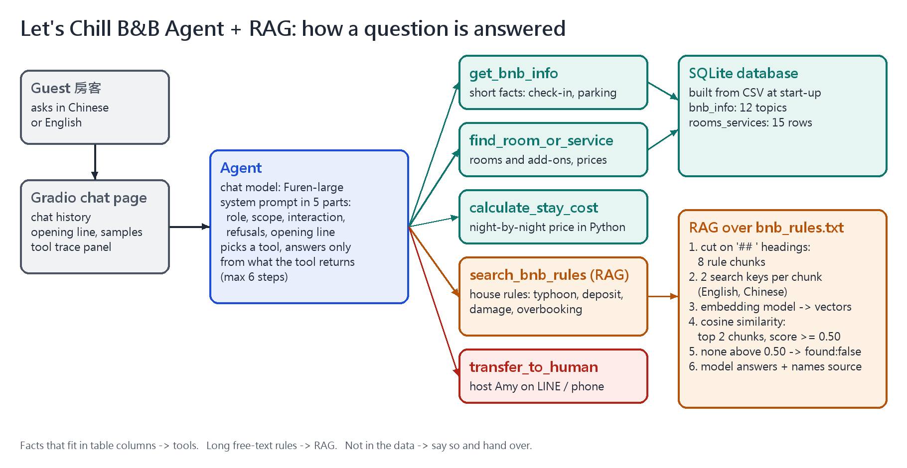

# Let's Chill B&B Agent + RAG: Rooms, Prices and House Rules for Guests

An AI customer service agent for **Let's Chill B&B (浪我們放空民宿)**, a small made-up B&B by Nanwan Beach in Kenting, Taiwan.
Guests ask in Chinese or English about rooms, prices and check-in, and about the B&B's **house rules**:
typhoons, the booking deposit and cancellation, the security deposit, damage and cleaning fees, and what happens if the booked room is not available.

> Course midterm project: My Own Language Model App (Units H and I). It grows the Unit G customer service homework
> ([lets-chill-bnb-agent](https://github.com/f115119122-cell/lets-chill-bnb-agent)) by adding **RAG**.
> Student: F115119122 Chu Yu-Xuan

## Who It Serves and Why

- **Users:** travellers planning a beach holiday in Kenting, before and during their stay.
- **What they need:** room prices and the cost of a stay, plus clear answers to "what if" questions:
  *A typhoon is coming on my check-in day. Do I get my deposit back? I broke a glass. How much do I pay? You have no room for me. What now?*
- **Why a general AI chat cannot do it:** it does not know this B&B's prices or its own rules, so it guesses.
  In Kenting, typhoon and refund questions are common, and a wrong promise costs the B&B money.

## Scope and Rules

The agent helps only with staying at this B&B. It must follow three rules:

1. **Never invent anything.** If the database and the house rules have no answer, it says so with a fixed sentence and hands over to the host.
2. **Never promise money by itself** (refunds, upgrades, discounts, compensation). It may quote the house rules, but the host confirms the final amount.
3. **Never say a room is free on certain dates.** It cannot see bookings; the host confirms dates on LINE.

The system prompt in [`app.py`](app.py) has five parts: role and goal, scope, interaction rules,
refusals and special cases (with exact sentences), and the opening line.

## How It Works



Every question goes to the agent. The model chooses a tool, and answers only from what the tool returns.
The panel on the right of the chat page shows each tool call, and for RAG the rule chunks found and their scores.

| Kind of data | Where it lives | How the agent reads it |
|---|---|---|
| Short facts (check-in time, parking, pets, transport) | `bnb_info.csv` → SQLite table `bnb_info` (12 topics) | tool `get_bnb_info` |
| Rooms and add-ons (prices, capacity, open or closed) | `rooms_services.csv` → SQLite table `rooms_services` (15 rows) | tool `find_room_or_service` |
| The price of a stay (weekday and weekend nights, add-ons) | calculated in Python | tool `calculate_stay_cost` |
| **Long house rules** (typhoons, deposits, damage, overbooking) | **`bnb_rules.txt`** (8 sections, Chinese and English) | **tool `search_bnb_rules` (RAG)** |
| Anything else (complaints, special requests) | — | tool `transfer_to_human` |

**RAG in this app**

1. At start-up, `bnb_rules.txt` is cut into chunks on its `## ` headings (one rule topic per chunk).
2. Each chunk gets **two search keys**: the title with the English text, and the title with the Chinese text.
   Each key is turned into a vector by the embedding model.
3. For a question, the app turns the question into a vector and finds the two closest chunks by cosine similarity
   (a chunk's score is the higher score of its two keys).
4. If even the best score is below `MIN_SCORE = 0.50`, the tool returns `found: false`, and the agent says the rules do not cover it.
5. The full chunks go to the model, which answers only from them and names the source.

Why two keys? Our test found that the embedding model **ignores text after a length limit**: adding unrelated text
at the end of a long chunk did not change its vector at all. With English first and Chinese second,
the Chinese half of each chunk was being cut off. Short, one-language keys fixed it.

- **Models:** chat model Furen-large and embedding model `Embedding` (NKUST AI Hub, OpenAI-compatible API)
- **Chat screen:** Gradio. Chinese is the default reply language; a button switches the replies to English.
- **Agent loop safety:** at most 6 model calls per question; only our own five tools can run;
  today's date and a 15-day calendar are given to the model.

## Tests

| Test | What it checks | Result |
|---|---|---|
| `test_tools.py` | the database and calculation tools, without the chat model | 19/19 passed |
| `test_rag.py` | the RAG search finds the right rule chunk (14 questions) and finds nothing for 4 questions the rules do not cover | 17/18 (the weather question scores 0.515, close to the typhoon rules; the system prompt then refuses it) |
| `test_tool_choice.py` | the agent picks the right tool, refuses tricks and out-of-scope questions (24 questions) | 24/24 |

## Project Files

```text
lets-chill-bnb-rag-agent/
├── app.py                # the agent: database, RAG, tools, system prompt, agent loop and chat screen
├── bnb_rules.txt         # the house rules, searched with RAG
├── bnb_info.csv          # short B&B facts
├── rooms_services.csv    # rooms and add-on services
├── test_tools.py         # tests the tools (19 checks)
├── test_rag.py           # tests the RAG search (18 questions)
├── test_tool_choice.py   # tool-choice and safety test with the chat model (24 questions)
├── requirements.txt      # the Python packages to install
├── .env.example          # a sample settings file (no real key)
├── .gitignore            # files git must not upload, such as .env
├── images/               # pictures for this README
└── README.md             # this file
```

## How to Install and Run It

1. Download the project:

   ```bash
   git clone https://github.com/f115119122-cell/lets-chill-bnb-rag-agent.git
   cd lets-chill-bnb-rag-agent
   ```

2. Install the packages (Python 3.10 or newer):

   ```bash
   pip install -r requirements.txt
   ```

3. Make your settings file. Copy `.env.example` to `.env`, then put your own key after `API_KEY=`.
   The chat model must support tool calling. If the embedding model is on the same server, you can leave the
   `EMBEDDING_*` lines empty: the app then uses the chat model's server and key.

   ```bash
   copy .env.example .env      # Windows
   cp .env.example .env        # macOS or Linux
   ```

4. Start the app. It builds the database, turns the house rules into vectors, then opens the chat page:

   ```bash
   python app.py
   ```

5. Open the link shown in the console, usually <http://127.0.0.1:7860>.

6. Optional tests (all of them need the API key, because the app embeds the house rules at start-up):

   ```bash
   python test_tools.py
   python test_rag.py
   python test_tool_choice.py   # calls the chat model about 50 times
   ```

## Notes

- The B&B, its rules, prices, names, phone number and LINE ID are all **made up** for a class project.
- `.env` holds the API key. It is **not** in this repository. Make your own from `.env.example`.
